<!-- HEADER -->

  

### ✦ Sobre mí

Desarrollador de software con experiencia en la creación de **aplicaciones web modernas, herramientas de escritorio y móviles multiplataforma**.  
Mi enfoque prioriza la **claridad estructural, el tipado estricto y el rendimiento**, desde interfaces reactivas hasta software nativo y ejecución local.

- **Nativo y multiplataforma:** desarrollo de herramientas ligeras de escritorio y Android con **Tauri v2 / Rust**.
- **Visión por computador local:** pipelines con modelos **YOLO26** ejecutados en CPU mediante **ONNX Runtime**.
- **Web & Gráficos:** aplicaciones full-stack tipadas con **TypeScript / React / Astro / Next.js** y **Canvas / Three.js**.

---

### ✦ Stack & Herramientas

  <b>Frontend, Web &amp; UI</b>  
  <picture>
    <source media="(prefers-color-scheme: dark)" srcset="https://skillicons.dev/icons?i=ts,js,react,astro,nextjs,tailwind,threejs,vite,html,css&amp;perline=10&amp;theme=dark" />
    <source media="(prefers-color-scheme: light)" srcset="https://skillicons.dev/icons?i=ts,js,react,astro,nextjs,tailwind,threejs,vite,html,css&amp;perline=10&amp;theme=light" />
    
  </picture>

  <b>Backend, Nativo, Datos &amp; Entorno</b>  
  <picture>
    <source media="(prefers-color-scheme: dark)" srcset="https://skillicons.dev/icons?i=tauri,rust,python,cs,nodejs,supabase,sqlite,git,github,pnpm,linux&amp;perline=11&amp;theme=dark" />
    <source media="(prefers-color-scheme: light)" srcset="https://skillicons.dev/icons?i=tauri,rust,python,cs,nodejs,supabase,sqlite,git,github,pnpm,linux&amp;perline=11&amp;theme=light" />
    
  </picture>

---

### ✦ Proyectos Destacados

- **[Sea Turtle Track](https://github.com/Snowclik/sea-turtle-track)**  
  Aplicación de escritorio y pipeline de visión por computador para la detección de rastros de anidación de tortugas marinas mediante drones (UAV), ejecutando modelos **YOLO26** sobre CPU con **ONNX Runtime**.  
  `Tauri v2` · `Rust` · `React` · `Python` · `YOLO26` · `ONNX Runtime`

- **[GraphicAlgo](https://github.com/Snowclik/GraphicAlgo)** — [Demo Web](https://graphicalgo.vercel.app/)  
  Herramienta interactiva de computación gráfica para visualizar y resolver problemas de geometría analítica y algoritmos de rasterización (*DDA*, *Bresenham* y *Punto Medio*) con cuadrícula dinámica y exportación a Excel.  
  `TypeScript` · `React` · `Canvas API` · `Tailwind CSS`

- **[FlorSave](https://github.com/Snowclik/FlorSave)**  
  Aplicación móvil ultraligera para Android que intercepta archivos, imágenes y documentos desde el menú nativo de compartir y los almacena localmente de forma silenciosa y 100% offline.  
  `Tauri v2` · `Rust` · `React` · `Kotlin` · `Android`

*(Otros repositorios y proyectos: generación programática de video en [videoai](https://github.com/Snowclik/videoai), visualización de algoritmos en [minimax-vs-alphabeta-viz](https://github.com/Snowclik/minimax-vs-alphabeta-viz), cifrado visual con GUI en [file2png-gui](https://github.com/Snowclik/file2png-gui), [Sendero](https://github.com/Snowclik/Sendero) y [NyuSeek](https://nyuseek.vercel.app/).)*

---

### ✦ Radar & Estadísticas

  

  <picture>
    <source media="(prefers-color-scheme: dark)" srcset="https://streak-stats.demolab.com?user=Snowclik&amp;background=070B14&amp;border=1E293B&amp;stroke=1E293B&amp;ring=38BDF8&amp;fire=A78BFA&amp;currStreakNum=F1F5F9&amp;sideNums=F1F5F9&amp;currStreakLabel=38BDF8&amp;sideLabels=94A3B8&amp;dates=64748B&amp;border_radius=14&amp;locale=es" />
    <source media="(prefers-color-scheme: light)" srcset="https://streak-stats.demolab.com?user=Snowclik&amp;background=F8FAFC&amp;border=E2E8F0&amp;stroke=E2E8F0&amp;ring=0284C7&amp;fire=7C3AED&amp;currStreakNum=0F172A&amp;sideNums=0F172A&amp;currStreakLabel=0284C7&amp;sideLabels=475569&amp;dates=64748B&amp;border_radius=14&amp;locale=es" />
    
  </picture>

---

### ✦ Arcade · Contribuciones

  <picture>
    <source media="(prefers-color-scheme: dark)" srcset="https://raw.githubusercontent.com/Snowclik/Snowclik/output/pacman-contribution-graph-dark.svg" />
    <source media="(prefers-color-scheme: light)" srcset="https://raw.githubusercontent.com/Snowclik/Snowclik/output/pacman-contribution-graph.svg" />
    
  </picture>

---

### ✦ Contacto

  &nbsp;&nbsp;&nbsp;&nbsp;

<!-- FOOTER -->

  

